<!-- ╔══════════════════════════════════════════════════════════════╗
     ║  NeoBro34 · profile README — custom animated SVGs in /assets  ║
     ╚══════════════════════════════════════════════════════════════╝ -->

  

  
  
  
  

 

<!-- ───────────────────────── 01 · ABOUT ───────────────────────── -->

  

<!-- ───────────────────────── 02 · PROJECTS ───────────────────────── -->

  <a href="https://github.com/NeoBro34/REPO_FOODIEKOREA"></a>
  <a href="https://github.com/NeoBro34/REPO_RESUME"></a>

  <a href="https://github.com/NeoBro34/REPO_ECOMMERCE"></a>
  <a href="https://github.com/NeoBro34/REPO_BOOKING"></a>

<!-- ───────────────────────── 03 · STACK ───────────────────────── -->

  

  

<!-- ───────────────────────── 04 · ACTIVITY ───────────────────────── -->

  
  

  

<!-- Snake is generated by .github/workflows/snake.yml into the `output` branch -->

  <picture>
    <source media="(prefers-color-scheme: dark)" srcset="https://raw.githubusercontent.com/NeoBro34/NeoBro34/output/snake-dark.svg"/>
    <source media="(prefers-color-scheme: light)" srcset="https://raw.githubusercontent.com/NeoBro34/NeoBro34/output/snake-light.svg"/>
    
  </picture>

<!-- ───────────────────────── 05 · CONNECT ───────────────────────── -->

  
  

  

